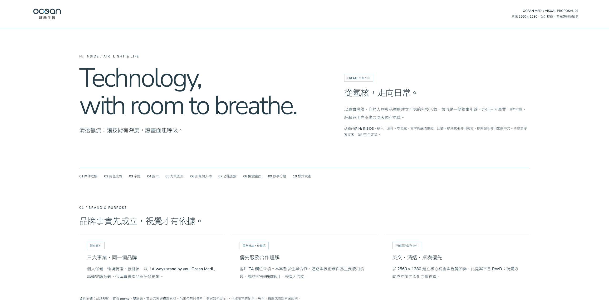
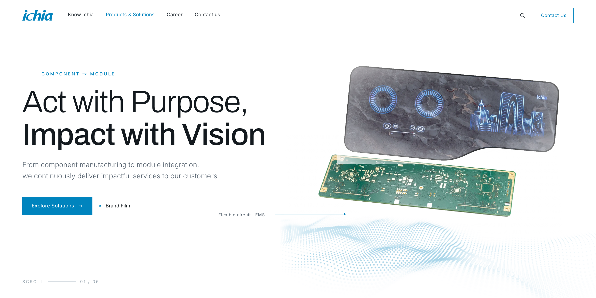
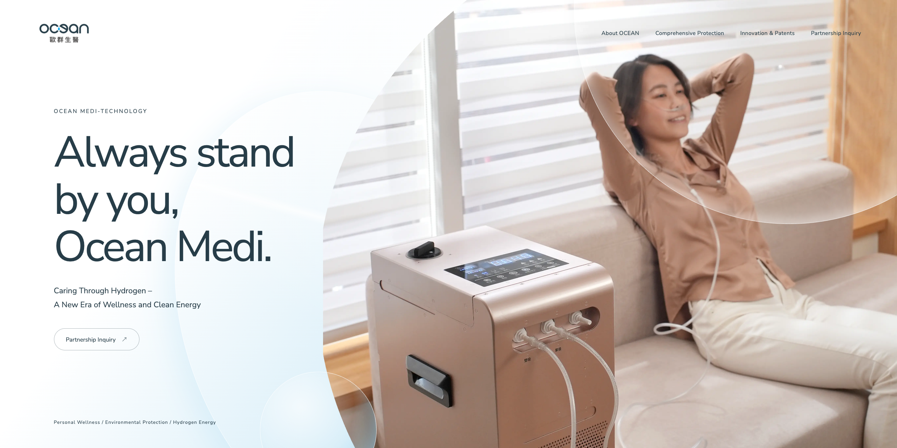
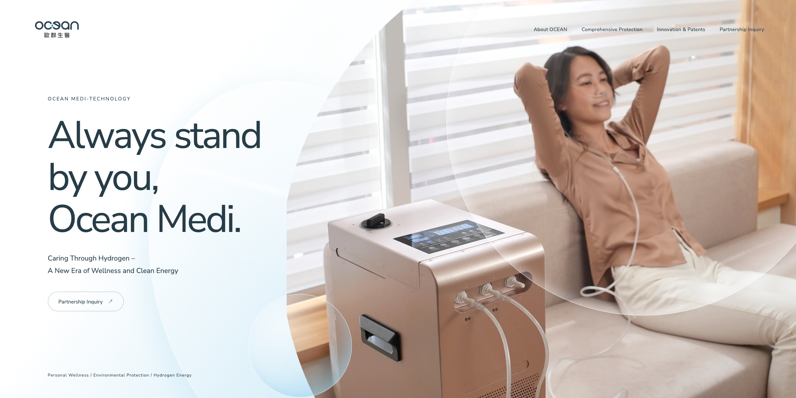
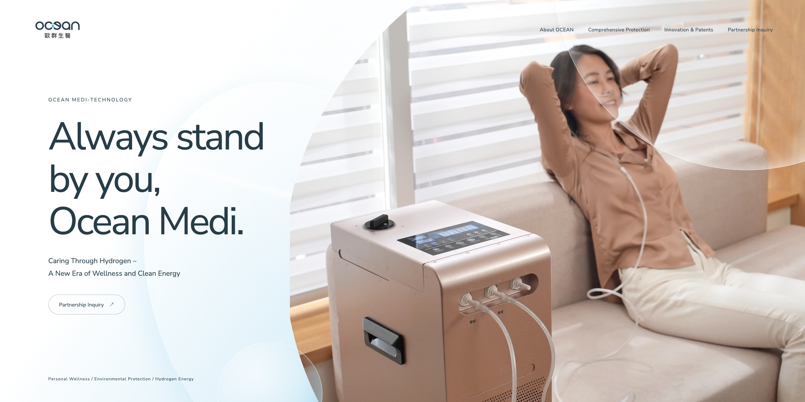
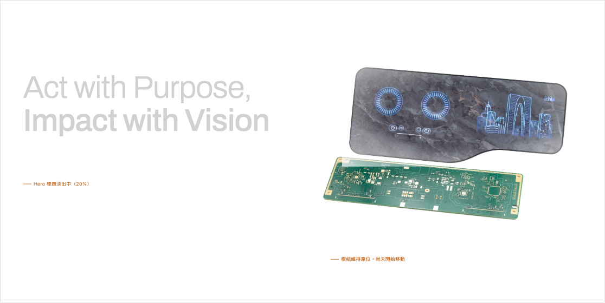
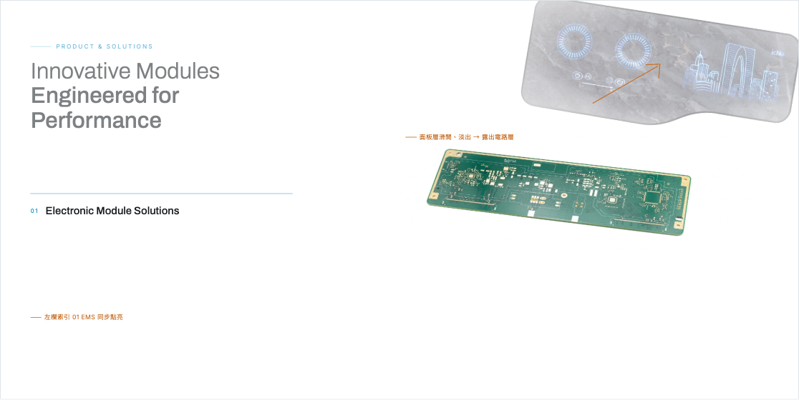
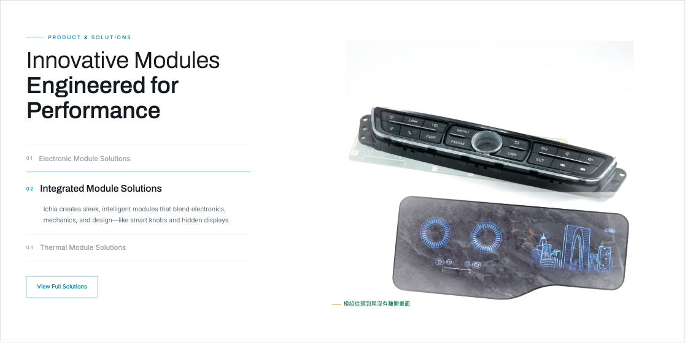

# layout 第一次製作｜完整流程

[教學入口：layout 第一次製作完整流程／依情境](index.html)

更新：2026-10-21 · 從案件準備到首頁製作與校稿

[先選目前情境：快速索引](快速索引.html)

你負責準備資料、確認方向、看預覽與給回饋；AI 負責整理、設計、製作與檢查。依目前階段貼對應指令，把括號內容換成本案資訊，不必一次貼完全部步驟。

## 直接使用已設定好的 Skill

**不需要自行下載、上傳或重複安裝 Skill。**

本手冊一律使用 Claude App。Skill 由維護者事先在 Claude 網頁版統一設定與更新；使用已完成設定的帳號或團隊空間，直接依工作階段貼指令即可。

- Visual-Solution-Workflow：整理品牌資料、確認視覺與動態方向，推進整體網站製作流程。
- Lin-EVO：依確認設計切版、修改與校稿。
- Miffy-EVO：將已確認的靜態網站轉成 EVO 匯入成果，檢查、打包並協助後台驗證。

找不到 Skill 時，請維護者確認目前帳號或團隊空間的使用權限，不必自行尋找安裝包。不同帳號須先完成分享或組織配置，不能把維護者個人帳號的安裝視為所有同事都已可用。

Skill 是工作規則，不等於取得檔案或後台權限。請提供案件檔案或 Claude App 已獲授權的可讀取來源；只貼本機路徑不代表能讀取。實際匯入與驗證仍需目標站台及操作權限。

## 第一次使用｜登入並確認可用

Skill 已由維護者負責設定。你只需登入指定帳號或團隊空間、確認規範可用，再提供案件資料；之後沿用設定，不必每次重新安裝。

### A｜登入指定的 Claude

開啟 Claude App，登入維護者已完成設定的帳號或團隊空間。登入與授權由你本人操作；若看不到指定 Skill，將畫面交給維護者處理。

### B｜確認 Skill 可用

第一次使用或設定更新後，貼上：

```text
本案一律使用 Claude App，不切換其他 AI 工具，也不另行詢問工具分工。
Skill 由維護者統一設定；請直接讀取 Visual-Solution-Workflow、Lin-EVO 與 Miffy-EVO。
請確認設計流程、Lin 切版與 Miffy 轉 EVO 的規範都能讀到，並核對隨附 evomni-html 的版本及檢查器。
回報實際讀到的版本與缺少項目；不能只因我說已設定就視為可用。
若缺少 Skill，列出需由維護者處理的項目，不要求我下載或安裝。
目前只確認 Skill，不開始製作網站、不推送或部署。
```

### C｜提供案件資料，開始工作

確認可用後，依第 1 步提供案件檔案與既有進度。之後接續原對話即可；開新對話時提供最新進度，不必重做 Skill 設定。

**做到這裡再往下：** Claude 已讀到本案所需規範。若有缺少項目，先交由維護者處理；可用後直接開始案件。

### 需要產圖時再準備

由 Claude 先整理圖片用途、構圖、比例與產圖提示詞（Prompt）。你再將提示詞貼到 ChatGPT 產圖，確認成品後，依指定檔名下載至本案的 `image/` 資料夾，供後續切版使用；完整存放位置由 Claude 說明。

## 第 1 步｜連結、整理檔案

每輪開始前，請提供最新案件檔案與進度，讓 Claude 核對目前版本再接續。Skill 設定與版本由維護者統一維護，不需要每輪重新安裝。

### A｜將專案檔案放到自己的 Google Drive

請將專案提供給你的檔案，複製到**自己的 Google Drive 案件資料夾**，請勿直接在共用區執行。

### B｜確認 PDF 讀取方式

**PDF 以「能不讀就不讀，必要時才讀」為原則。** 整份讀取可能消耗大量 token，尤其是頁數多、圖文複雜的文件。若能用重點文字、指定頁面的截圖或既有整理資料說明，就不必讀取整份 PDF；確實需要時，也只讀與本次工作相關的頁面，避免重複讀取。

PDF 可以保留。Skill 會先列出案件資料夾及子資料夾中的 PDF 並檢查大小，未超過 10 MB 才在讀取內容前詢問：「這些 PDF 需要讓 AI 現在先讀嗎？還是有要用到再讀？」

單一 PDF 超過 10 MB（10,000,000 bytes），AI 一律拒絕讀取，即使你要求也不例外。請直接截圖提供需要的重點，或將重點整理成 Markdown（.md）檔案提供；原檔保留並標記未讀取。

為避免不必要的 token 消耗，選擇用到再讀的 PDF 會先集中到 `04_型錄與原始素材/PDF_待用時讀取/`，並標記尚未讀取；後續需要時只讀相關檔案或頁面。

### C｜請 Skill 整理資料夾

檔案備妥並提供給 Claude App 後，請 Skill 盤點、分類。沒有資料夾寫入工具時，由 Claude 提供整理後的檔案與目錄清單，你下載保存到自己的案件資料夾，不宣稱已修改電腦上的原檔。

**貼給 AI：**

```text
使用 Visual-Solution-Workflow，依整體視覺網站的案件規範，盤點並整理本案資料夾。
請一律依標準目錄歸位，正式網站工程放在 06-切版/，進度與交接文件放在 05_待確認與交接/；搬移既有檔案時同步修正引用並驗證。
本輪只整理案件資料、素材與既有進度，不開始設計或切版。

PDF 以必要時才讀為原則，優先使用重點文字、指定頁面截圖或既有整理資料；確實需要時只讀相關頁面，避免整份或重複讀取。
遇到 PDF 請先檢查大小，單一檔案超過 10 MB 一律拒絕讀取；未超過上限才詢問要現在先讀，還是有要用到再讀；選擇用到再讀的 PDF 請整理到獨立資料夾並標記尚未讀取。
請先讀取資料與既有進度，再依本案規範整理資料夾、素材、文件及目前工作入口。
保留既有網站的資源引用與已確認成果，列出整理結果及缺少的資料。
```

### 整理後的資料夾會像這樣

需求、品牌素材、頁面資料與待確認事項分開放；先看 README.md，就能找到目前的工作入口。

```text
自己的 Google Drive／案件名稱/
├── README.md                     案件說明、目前入口與預覽方式
├── 01_專案需求與規劃/            需求、架構、視覺與動態提案
├── 02_品牌素材/                  Logo、CIS、字型與共用素材
├── 03_頁面製作素材/              各頁面的文案、圖像及製作資料
│   ├── 03_01_首頁/               首頁各區塊資料
│   └── 03_02_關於我們/           依本案頁面清單延伸
├── 04_型錄與原始素材/            客供型錄、原始圖片與影片
│   └── PDF_待用時讀取/           已選擇用到再讀、尚未讀取的 PDF
├── 05_待確認與交接/              進度、待確認事項與交付資料
│   ├── experience-status.md      目前進度；已有進度檔就沿用
│   └── 工程師交接說明.md         切版後建立並持續更新的唯一交接文件
├── 06-切版/                     正式網站程式與使用素材；第 7 步開始使用
└── 99_歸檔/                     需要保留的舊提案與試作
```

整理案件時一律依這份標準目錄歸位，新案件與既有案件都適用。06-切版/ 統一存放正式網站工程，第 7 步開始使用；先建立資料夾不代表已完成切版。搬移既有檔案時須同步修正資源引用與預覽路徑，並更新 README.md 的實際入口。

**做到這裡再往下：** 檔案位於自己的 Google Drive 案件資料夾，PDF 的讀取方式與暫存位置已確認，Skill 已完成整理並說明資料位置與缺口。

## 第 2 步｜在 Claude App 開始案件

參考用途請選清楚：**忠實重建**是沿用約定的版面及動態；**指定特徵轉譯**是保留喜歡的特徵、重新設計；**原創方向**是以本案品牌發想，參考只校準品質。

**貼給 AI：**

```text
使用 Visual-Solution-Workflow，接續已整理好的案件資料，開始本案。

請先讀取案件資料與既有進度，整理品牌、網站需求、素材及缺少的資料；已有資訊不重複詢問。

設計稿與參考：（填連結或位置，沒有就寫沒有）
參考用途：（忠實重建／指定特徵轉譯／原創方向）
想保留的參考特徵：（填具體區塊或效果，沒有就寫沒有）

需要產圖時，由你提供提示詞（Prompt）、檔名與 image/ 資料夾的完整位置，我貼到 ChatGPT 產圖，確認後下載至該資料夾。

先做 2560×1280 桌機首頁，依方向、視覺、動態、核心片段、完整首頁的順序讓我確認。
桌機內部確認後接續 RWD，完成檢查再交客戶校稿。

請將本案範圍、確認結果與下一步記入進度；已有確認內容直接沿用，不重新開始。
```

## 第 3 步｜確認設計方向

確認設計方向前，Claude 必須先實際查看並分析你提供的參考網站、截圖或影片；沒有可用參考時，就透過 Eagle 查找與查看，可使用已連接的 Eagle 工具或已授權的螢幕操作。兩種方式擇一完成即可，不要求一定連接 Eagle。若都沒有可分析的參考，先補資料或完成工具設定，再往下進行。

原創案件由 AI 提出 2–3 個概念不同的方向，說明適合的原因與推薦。看它是否符合品牌、客群與網站目的；忠實重建則先確認保留與可替換範圍，沿用約定參考。看過參考不等於方向已確認，仍須由你確認設計方向。

**貼給 AI：**

```text
我選擇方向：（填名稱）。
想保留：（填喜歡的部分）。
需要調整：（填不適合的部分）。
請記錄確認方向，再準備視覺提案。
```

**做到這裡再往下：** 方向與參考使用邊界已清楚。沒有 CIS 時，AI 提出的色彩、字型等建議需經你確認，才能作為本案網站的視覺約定。

## 第 4 步｜確認視覺提案

看實際構圖、色彩比例、字體、圖示、背景圖騰、形象圖片與功能圖解，以及它們怎麼用在主要區塊。AI 應提供可觀看的畫面，不能只有風格形容詞或色碼清單。

視覺提案時，Claude 會盤點客供素材並列出缺圖。需要產圖時，先確認用途與構圖，再由 Claude 提供 Prompt、檔名與 `image/` 資料夾的完整位置，你貼到 ChatGPT 產圖，確認後下載至該資料夾。正式 Logo、產品、角色及 IP 沿用客供原檔。

確認基準是 **2560×1280 的瀏覽器內容區域**。你的螢幕較小時，請 AI 提供該尺寸截圖或對應預覽，自己再看可操作版本；縮小截圖不代表已驗證小螢幕版。

### 視覺提案案例｜Ocean Medi 歐群生醫

這份提案示範如何把品牌依據、色彩比例、字體、圖示、照片與關鍵構圖放在同一份文件中確認。閱讀時看三件事：品牌資料如何影響設計、視覺元素如何一起使用，以及哪些是正式素材、哪些仍待確認。

[](Ocean-Medi-歐群生醫/視覺提案-v1.html)

[開啟完整視覺提案案例](Ocean-Medi-歐群生醫/視覺提案-v1.html)

這是歷史桌機提案的展示案例；本案品牌方向與製作順序仍依自己的案件及目前手冊執行。

### 視覺提案案例｜Ichia 毅嘉科技

這份提案示範如何把「從零件到模組」的品牌概念，轉成層疊產品構圖、企業藍、編輯式留白與全頁關鍵畫面。下圖是首頁構圖；開啟完整提案可查看色彩、字體、圖形、影像處理，以及待確認項目。

[](Ichia-毅嘉科技/視覺提案-v1.html)

[開啟完整視覺提案案例](Ichia-毅嘉科技/視覺提案-v1.html)

## 第 5 步｜確認動態提案

AI 用分鏡展示主要區塊的開始、過程與結束，說明往下捲動、往回捲動、點擊時會看到什麼，以及文字停留與閱讀時機。全頁要有強弱節奏，不能只設計首屏。

### 動態分鏡案例｜Ocean Medi 歐群生醫

這份分鏡把同一個 Banner 分成起始、移動中、停留三個狀態，並列出圖層、觸發、速度、回捲與減少動態的做法。開啟完整案例後，可按上方按鈕切換分鏡，檢查前景位置與主體是否被遮擋。

**01 起始：** 主體與文字先看清，透明前景停在邊界。

[](Ocean-Medi-歐群生醫/動態腳本-Banner層次與動態分鏡-v1.html?frame=start)

**02 移動中：** 前景向內移動，主體與文字維持穩定。

[](Ocean-Medi-歐群生醫/動態腳本-Banner層次與動態分鏡-v1.html?frame=middle)

**03 停留：** 前景退回邊界，讓畫面穩定並銜接下一段。

[](Ocean-Medi-歐群生醫/動態腳本-Banner層次與動態分鏡-v1.html?frame=end)

[開啟完整動態分鏡案例](Ocean-Medi-歐群生醫/動態腳本-Banner層次與動態分鏡-v1.html)

這裡展示的是分鏡定格狀態；動態手感與流暢度在下一步核心片段試做時再確認。

### 動態分鏡案例｜Ichia 毅嘉科技

這份腳本把首頁、產品與 ESG 的銜接分成 Scene A、B、C，並說明全頁強弱節奏、捲動觸發、反向行為與減少動態方案。下方選用 Scene B「模組換層」的三個狀態，示範動態如何解釋產品內容。

**01 起始：** 首頁文字退場，模組維持原位。

[](Ichia-毅嘉科技/動態腳本-v1.html#b)

**02 過程：** 面板滑開露出電路層，左欄同步顯示 EMS。

[](Ichia-毅嘉科技/動態腳本-v1.html#b)

**03 結束：** 切換至 IMS 內容與產品構圖，完成段落銜接。

[](Ichia-毅嘉科技/動態腳本-v1.html#b)

[開啟完整動態分鏡案例](Ichia-毅嘉科技/動態腳本-v1.html)

這是分鏡構圖示範，原腳本尚未實作動畫；實際速度與捲動手感需在核心片段試做時確認。

**做到這裡再往下：** 你理解並同意動態做法，再回覆「這版動態提案確認，請試做核心片段」。此時尚未確認實際動畫成品。

## 第 6 步｜試玩核心片段

核心片段仍由 **Visual-Solution-Workflow** 試做與調整，讓你確認實際構圖與動態。確認通過後，才呼叫 Lin-EVO 接續完整網站切版。

AI 做出最能驗證構圖與動態的片段，提供可操作預覽。自己試正反向捲動、快速捲動、點擊與重新載入，確認速度、閱讀與操作符合預期。

**做到這裡再往下：** 片段符合預期，再回覆「這版核心片段確認，請記錄確認版本、動態規格與素材位置，接著使用 Lin-EVO 延伸完整桌機首頁」。片段通過只代表該範圍通過。

## 第 7 步｜使用 Lin-EVO 製作完整桌機首頁

**注意：若已有可用的系統範本，請直接提供連結，指出要參考的區塊，並明確告訴 Lin-EVO：「這是系統範本，請依照這個參考區塊切版。」**

核心片段確認後，從這一步開始使用 **Lin-EVO** 切版，沿用已確認的設計、動態與素材，不重新提案。後續內頁、RWD 與切版修正也使用 Lin-EVO；靜態網站確認後，再由 Miffy-EVO 進行 EVO 轉換。

從頁首看到頁尾，檢查內容層級、圖片裁切、留白、全頁動態與 CTA（引導使用者採取行動的按鈕）。試選單、連結、輪播、下滑固定導覽與右下角回到頂部。

由 Claude App 依確認的全頁場景、規格與素材製作，完成後仍須實看驗收。自查有缺陷應先修正；暫代文案、缺圖、未完成功能及無法實測的項目要明列。

切版完成後，AI 會提醒你檢核專案檔案大小，並列出網站使用的非 WebP／SVG 圖片及其路徑、大小。請自行轉成適合網頁的格式後提供；Claude 不代為轉檔、壓縮或批次處理圖片，以避免額外 token 消耗。WebP／SVG 也要確認實際容量。

**貼給 AI：**

```text
使用 Lin-EVO，接續已確認的核心片段，完成並自行檢查完整桌機首頁，開啟目前有效版本的預覽。
從頁首到頁尾確認構圖、圖片、文案、動畫、導覽與回到頂部。
一起準備 Cookie 提示與可閱讀的隱私權政策頁。
請列出待補資料、暫代內容、未完成功能及實際測試範圍。
切版完成後請提醒我檢核專案檔案大小，列出非 WebP／SVG 圖片的路徑與大小，由我自行轉檔；Claude 不代為處理。
```

### Lin-EVO 切版完成後，資料夾會像這樣

正式切版一律放在案件資料夾的 `06-切版/`，與客戶資料、提案及原始素材分開。以下展開這個資料夾的內容；進度檔與工程師交接說明統一放在 05_待確認與交接/，不在切版資料夾重複建立。從案件根目錄 README.md 查閱實際首頁入口與預覽方式。

```text
06-切版/
├── index.html                   首頁入口
├── about.html                   關於我們；後續內頁示例
├── search.html                  搜尋結果頁
├── privacy.html                 隱私權政策頁
├── scss/                        樣式原始檔
│   ├── _common.scss             全站變數與共用樣式
│   ├── _header.scss             導覽樣式
│   ├── _footer.scss             頁尾樣式
│   ├── _innerpage-default.scss   內頁共用樣式
│   ├── evomni-root.scss         共用樣式編譯入口
│   ├── _index.scss              首頁樣式；存檔編譯至 css/index.css
│   └── _about.scss              關於我們樣式；存檔編譯至 css/about.css
├── css/                         網頁實際載入的編譯結果，不直接手改
│   ├── evomni-root.css          共用編譯結果
│   ├── index.css                首頁編譯結果
│   └── about.css                關於我們編譯結果
├── js/                          導覽、輪播與動態等互動程式
│   ├── header.js                選單、漢堡與語系互動
│   ├── footer.js                回頂部與全站共用初始化
│   ├── index.js                 首頁專屬互動
│   └── about.js                 內頁專屬互動；有需要才建立
└── assets/                      網站實際使用的素材
    ├── image/                   圖片、Logo 與圖示
    └── fonts/                   本案使用的字型檔；有檔案時才建立
```

切版成果統一放在 `06-切版/`。檔案分工、編譯設定與資源載入由 Lin 依規範處理；需要你配合操作時，會提供具體步驟。

## 第 8 步｜PC 看稿確認後，使用 Lin-EVO 完成 RWD

PC 首頁製作完成並經看稿確認後，請 Lin-EVO 接續完成首頁 RWD。保留已確認的設計與內容，依不同螢幕調整排列、圖片裁切、導覽與動態，不是直接縮小桌機畫面。

**貼給 AI：**

```text
PC 首頁已完成並看稿確認，請使用 Lin-EVO 完成首頁 RWD。
請沿用已確認的首頁版本；平板與手機尺寸尚未約定時，先提出建議。
保留確認內容與主要操作，依小螢幕調整版面及動態。
請提供對應預覽，讓我檢查選單、文字、圖片、按鈕及觸控操作。
```

## 第 9 步｜首頁完成後，推送到 Git

首頁 PC 與 RWD 完成並經看稿確認後，先將首頁校稿版推送到公司 Git，再取得 62 DEMO 外網連結。這一步不必等待內頁全部完成；尚未完成的頁面需明列，避免誤認為整站已交付。

### 內部 Git 操作教學

### A｜到效率雲開版

先到效率雲開版本案的 Evomni，確認本案的**網站代號**，後續資料夾名稱與指令中的專案資料都使用這個代號。

### B｜在本機建立 project 資料夾

在你的電腦本機選一個固定位置，建立名為 **project** 的資料夾，專門存放 Git 切版專案。**已經有 project 就沿用，不用重複建立。**

**project 裡只能放切版專案資料，其他資料一律不要放。** 客戶原始資料、提案、參考與案件管理文件留在原本的案件資料夾，不放進這裡。

### C｜在 project 裡建立「你的網站代號」資料夾

在 `project` 裡新增一個資料夾，名稱填入效率雲開版取得的**網站代號**，不是直接命名為「你的網站代號」。

### D｜複製 06-切版 裡的全部檔案

打開案件資料夾中的 `06-切版/`，將裡面的所有切版檔案與子資料夾，完整複製到 `project/你的網站代號/`。**複製的是 06-切版 裡面的內容，不是把整個 06-切版 資料夾再包進去。** 原案件檔案保留。

```text
project/
└── 你的網站代號/
    ├── index.html
    ├── 已完成的其他頁面.html
    ├── scss/
    ├── css/
    ├── js/
    └── assets/
```

以上為位置示意，實際依 `06-切版/` 的完整內容複製。首頁 `index.html` 應直接位於網站代號資料夾內；先確認來源沒有混入帳密或其他非切版資料。

### E｜將網站代號資料夾拖曳到 VSCode

將 **「你的網站代號」資料夾直接拖曳到 VSCode** 開啟，不是拖入外層的 `project`。確認左側檔案總管顯示的是這個網站的檔案。

### F｜開啟終端機，逐一執行三個指令

在 VSCode 上方選單選擇 **「終端機 → 新增終端機」**，確認目前位置是 `project/你的網站代號/`。

開啟公司教學 [內部 Git 專案空間使用說明（文件 2335）](http://posthub.miracle-single.tw/docsys/#/articles/publish/2335)，依 **「情況 A：新網頁建立新專案」** 的三個指令操作：填入本案資料，**一個一個輸入並執行，確認成功後才執行下一個**，直到最後一個發布到 `.62` 的指令完成。指令內容以公司教學為準，不自行改寫。

公司 Git 需要公司網路或 VPN；帳密由你本人輸入。若指令出現錯誤，先處理錯誤，不直接繼續下一個。

### G｜修改一個 HTML，commit 並 push

最後一個發布到 `.62` 的指令完成後，在這個專案裡打開任一 HTML，刪除一段**不影響功能的普通說明註解**並存檔，產生一次檔案變更。不要刪除畫面內容、版權聲明、系統標記或程式需要的註解；不確定哪段可刪時，請 Lin 協助確認。

在 VSCode 左側開啟 **「原始檔控制」**，檢查變更內容，暫存要提交的變更、填寫提交訊息並 **commit（提交）**，接著 **push（推送）** 到公司 Git。確認推送成功；只存檔或只 commit 都還沒有推送到遠端。

### H｜回效率雲開版位置取得連結

推送完成後，回到**效率雲本案開版的位置**，查看 **62 DEMO 連結**。打開連結確認這次首頁內容與圖片正常顯示，才算完成本次發布；尚未出現連結或仍是舊內容時，先查發布狀態，不直接當成成功。

用這個連結檢查首頁與 RWD，確認客戶能正常查看，再提供首頁校稿。請 AI 在進度中記錄案件版號、外網連結、本次校稿版本與尚未完成的內頁。後續內頁完成後，沿用同一 Git 專案更新校稿版。

### I｜到 GitLab 取得 Git 專案網址

1. 在公司網路或 VPN 環境下，開啟 [GitLab 切版專案列表](http://192.168.168.134/client-html-demo/)。
2. 找到**你的網站代號**，點進該專案。
3. 點選頁面上方藍色的 **Code** 按鈕。
4. 在展開的選單中，複製 **Clone with HTTP** 的網址。

這就是本案的 **Git 專案網址**，請記錄在案件進度中，供之後下載專案或交接使用；它和效率雲取得的網站預覽連結不同。

> 以上是第一次建立專案的流程；**已有 Git 專案時沿用原專案，不重複執行新專案初始化。**

[來去看情境使用](快速索引.html)
